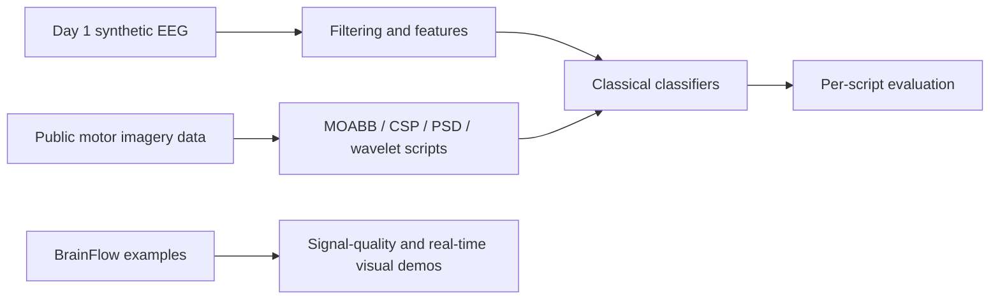

# BCI 10-Day Sprint

A collection of short EEG/BCI exercises spanning synthetic signals, filtering, feature extraction, classifiers, motor imagery, P300, and real-time signal-quality demos.

## Results

The repository does not publish one consolidated, reproducible benchmark across the sprint. Individual scripts print task-specific scores, and the day-one synthetic signal script ran to completion in a headless check; synthetic labels are a software exercise, not evidence of EEG decoding performance. No portfolio-level accuracy is claimed.

## Architecture



## Quickstart and verification

Verified command for the synthetic day-one exercise:

```bash
python day1_eeg_sim_py.py
```

It completed headlessly with plotting warnings. The repository has no single dependency manifest or unified runner, so this does not verify the other scripts. Each script may require additional libraries or dataset downloads.

## Limitations

- “10 day” is a set of separate scripts, not a single end-to-end application.
- Dependency management, shared preprocessing, and results tracking are inconsistent.
- Synthetic and public-dataset outputs should not be presented as live-headset performance.
- fMRI examples share the repository with EEG examples, broadening the scope further.

## Next steps

1. Add a project-level `pyproject.toml` with optional dependency groups.
2. Organize the scripts by day/task and document a tested command per script.
3. Add a results table recording dataset, split, metric, and exact command.
4. Select one best-supported pipeline and evolve it into the maintained project.
